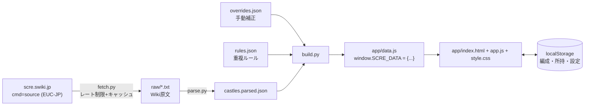

# 城プロRE 編成補助ツール 設計書（v0.1）

参考画面: 

## 1. 目的・方針

- 城プロRE の **編成時のバフ/デバフを一目で把握** する、自分専用の HTML ツール。
- ゲームにはアクセスしない。画像も使わない。**[城プロRE wiki](https://scre.swiki.jp/) の公開情報を自分用に整理**して使う。
- サーバー不要。**`index.html` をダブルクリックするだけで動く**（オフラインで使える）こと。
- スマホ縦画面を優先する（参考画面と同じ）。PC でも崩れないようにする。

> [!CAUTION]
> wiki のデータは個人利用にとどめ、再配布（公開リポジトリや公開サイトへの掲載）はしない。スクレイピングは **2〜3 秒に 1 リクエスト以下**にし、取得した結果をキャッシュして、同じページを何度も取りに行かないようにする。

---

## 2. 全体構成

2 つのパーツに分ける。①**データ生成**（たまに手元で実行）と、②**閲覧アプリ**（普段使うもの）。



> [!IMPORTANT]
> `file://` で開いたときは `fetch('data.json')` がブラウザに止められる。そのためデータは **`data.js`（グローバル変数に代入する JS ファイル）** として出力し、`<script src>` で読み込む。

### ディレクトリ

```
scre-helper/
├─ tools/                 # Python 3.11+, requests のみ
│  ├─ fetch.py            # wiki取得（一覧→各城娘ページ原文）
│  ├─ parse.py            # PukiWiki原文→構造化JSON
│  ├─ effect_parser.py    # 効果テキスト→Effect[]（正規表現）
│  ├─ build.py            # parsed + overrides + rules → app/data.js
│  └─ cache/raw/          # 取得原文（git管理外）
├─ data/
│  ├─ overrides.json      # パースできなかった効果の手動補正
│  ├─ aliases.json        # 愛称・表記ゆれ（例: "熊本"→"熊本城"）
│  └─ rules.json          # バフの重複・上限ルール
└─ app/
   ├─ index.html
   ├─ style.css
   ├─ app.js              # 素のJS（ES2020, フレームワークなし, ビルド不要）
   └─ data.js             # 生成物
```

---

## 3. データ取得（fetch.py）

| 項目 | 内容 |
|---|---|
| 一覧の取得元 | `全城娘一覧` ページ（城娘名とページ名を取る）。必要に応じて `ステータス一覧/能力値` も使う |
| 各ページ | `https://scre.swiki.jp/index.php?cmd=source&page=<URLエンコードしたページ名>` の `<pre id="source">` の中身 |
| 文字コード | **EUC-JP**（`resp.content.decode('euc_jp', errors='replace')`）。URL エンコードも EUC-JP で行う |
| キャッシュ | `cache/raw/<ページ名>.txt`。すでにあるページはスキップする。`--refresh 名前` で個別に取り直せるようにする |
| 差分更新 | `RecentChanges` を見て、更新されたページだけ取り直す（Phase 2） |
| 礼儀 | 2.5 秒 sleep を入れる。User-Agent に個人利用であることを書く。並列取得はしない |

### Wiki 原文の構造（熊本城ページで確認したもの）

```
|~|>|~|城属性|&ref(画像ブ/山.png,nolink);     ← 城属性は画像ファイル名から取る（平/平山/山/水/地獄/無）
|~|>|~|武器属性|[[刀]]
|~|>|~|レア|7
|~|コスト|11|コスト((本丸含みます))|127
|~|耐久|2523/&color(Red){―};|耐久|5298/...  ← 左 = 配置時、右 = 巨大化5段階
|~|攻撃|123/...|攻撃|233/...
|>|>|>|>|...''[[特技]]''|
|...[改] / 猪返し|>|>|>|自身の与ダメージが20%上昇&br;射程内の敵の移動速度が30%低下|
|...''[&color(Red){改壱};] / 猪返しの石垣''|...|  ← 太字（''）になっている行が最終段階
|>|>|>|>|...''[[計略]]''|
|...&br;（再使用まで45秒：気5）|>|>|>|20秒間射程が40上昇...|
```

- 特技・計略・特殊能力は、**最終段階（`''` で囲まれた太字の行）** だけを使う。それ以外は `stages[]` として残しておく。
- `&br;` は改行に、`&color(...){x};` は `x` に、`[[a>b]]` は `a` に変換してからパースする。
- 「改」「真」などの別バージョンの城娘は、**別エントリ**として扱う（`[改] 熊本城` のように表示）。

---

## 4. データモデル

```ts
type Castle = {
  id: string;            // ページ名（例 "熊本城", "［温泉］丸岡城"）
  name: string;          // 表示名
  aliases: string[];     // 愛称・略称
  rarity: number;        // 1-7
  castleType: "平"|"平山"|"山"|"水"|"地獄"|"無";
  weapon: string;        // 刀, 槍, 弓 ...
  rangeKind: "近"|"遠"|"両"|"-";
  cost: number;
  stats: { lvMax: Stats; giant5: Stats };   // hp, atk, def, range, recovery
  skill:    Ability | null;   // 特技
  strategy: Ability | null;   // 計略（cooldown, cost も持つ）
  special:  Ability | null;   // 特殊能力
  wikiUrl: string;
  parseWarnings: string[];    // パースできなかった文
};

type Ability = { name: string; text: string; cooldown?: number; cost?: number; effects: Effect[] };

type Effect = {
  source: "skill"|"strategy"|"special";
  stat: StatKey;          // 下の一覧から選ぶ
  mode: "percent"|"flat"|"mult"|"share";   // share = 「◯◯の攻撃の63%」のようなステータス共有
  value: number;          // 20 → 20% / +20
  target: Target;         // 対象
  side: "buff"|"debuff";  // 敵へのデバフは debuff
  duration?: number;      // 秒。計略の効果時間
  stackable?: boolean;    // 文中に「効果重複」とあるもの
  condition?: string;     // 「巨大化毎」「伏兵配置時」など。表示用の文字列
  raw: string;            // 元になった文（内訳に表示する）
};

type StatKey = "atk"|"def"|"range"|"hp"|"recovery"|"dmgDealt"|"dmgTaken"
  |"atkSpeed"|"gapShorten"|"defIgnore"|"enemyAtkDown"|"enemyDefDown"
  |"enemySlow"|"enemyDmgTakenUp"|"kiGain"|"cooldownShort"|"costDown"|"other";

type Target = { scope: "self"|"inRange"|"all"|"allyOthers";
                filter?: { weapon?: string[]; castleType?: string[]; rangeKind?: string } };
```

### effect_parser の方針

- `、` `。` `&br;` で文を区切り、**よく出てくる言い回しを正規表現の表で順番に照合**する（新しい言い回しは表に 1 行足すだけで対応できるようにする）。
  - 例: `(自身|射程内の城娘|射程内の(?P<w>\S+?)の城娘)の(?P<stat>攻撃|防御|射程|与ダメージ)が(?P<v>\d+)(?P<u>%|)上昇`
  - 例: `射程内の敵の(?P<stat>攻撃|防御|移動速度)が(?P<v>\d+)%低下` → debuff
  - 例: `(\d+)秒間` → duration、`効果重複` → stackable
- どの表にも当てはまらない文は `parseWarnings` に入れ、アプリ上では「⚠ 要確認」と表示する。
- `overrides.json` に書いた内容は、パース結果より**優先**する（城娘 id と source ごとに Effect[] をまるごと差し替える）。

---

## 5. 計算ルール（rules.json）

> [!WARNING]
> 細かい重複ルールは、実装の前に wiki の `用語集`・`検証` ページで確認する。**コードに直接書かず、`rules.json` で設定できるようにしておく**こと（あとから直せるように）。

最初に入れておく想定（参考画面の注記に合わせたもの）:

| カテゴリ | 合算方法 |
|---|---|
| 割合バフ（攻撃/防御/射程 %） | 同じ stat・同じ「枠」の中では**最大値だけ**を使う。`stackable` のものは加算 |
| 枠の分け方 | `self`（自分だけが対象）と `others`（他の城娘も対象）は別枠として、両方を適用する |
| 固定値バフ（+250 など） | **すべて合計** |
| 与ダメ / 被ダメ | 割合バフと同じ扱い（最大値。重複指定があれば加算） |
| 敵デバフ（攻撃↓・防御↓・移動↓） | 最大値 |
| ステータス共有（share） | 別の行として「＋（小早川城の攻撃の63%）」のように表示する。数値は合算しない |
| 前提 | **全員がお互いの射程内にいる**ものとする。計略は「ON」になっている城娘の分だけ数える |

計算結果は、stat ごとに `{ total, percentMax, flatSum, breakdown: Effect[] }` の形で返す。「内訳▾」を押すと breakdown を開けるようにする。

---

## 6. 画面設計

上部にタイトルバー（えんじ色 `#7a2e2e`、右上に「編成 n/8」）、その下にタブバー。**タブ 6 つ**。


### 6.1 編成タブ（参考画面の左側）
- 最大 8 枠。1 枠ごとに: 城属性・武器のアイコン（**画像ではなく文字かSVGのバッジ**）、名前、`[山] ★7・攻1608・1撃6174`。
- 右側にトグルボタン `計略 ON/OFF`、`特殊 ON/OFF`（その能力を持つ城娘だけ表示する）、`×` で外す。
- 空いている枠をタップ → 一覧タブが「選択モード」で開く。名前をタップ → その城娘の詳細を開く。
- 枠の並べ替え（ドラッグ。Phase 2 でよい）。
- **まとめて読み込む**: テキスト欄に名前を貼り付けて（読点・改行区切り）→「名前で読み込む」。aliases を使ったあいまい一致で探す。候補が複数あるときは選ばせる。
- 「編成を空にする」ボタン。編成を名前を付けて保存/呼び出し（スロット 5 個程度）。
- 「スクショから読み込む」は **Phase 3（任意）**。Tesseract.js を使った OCR で、CDN から読み込むためオンラインのときだけ使える。

### 6.2 一覧タブ
- 検索ボックス（名前・愛称・効果の文章が対象）、フィルタ（城属性・武器・レア・近/遠・所持のみ）、並べ替え（No./攻撃/コスト）。
- 1 行に名前、属性、そして持っているバフの種類を小さなタグで表示する（例 `攻%` `与ダメ` `防無視`）。
- 「所持」チェック（設定で ON にしたときだけ候補に使う）。

### 6.3 バフ/デバフタブ（参考画面の右側。**メイン機能**）
- 一番上に注記「全員が互いの射程内にいる前提で…」。
- 城娘ごとのカード: 自分の素のステータス（攻/防/耐/射/1撃）→ 受けているバフを stat ごとに 1 行ずつ。
  - `攻撃  +10% 嵩嵩（自身）・特技（重複）` のように、**値は緑、出どころは灰色**で表示する。
  - 固定値は `+470 固定値の合計（3件） 内訳▾`。
  - ステータス共有は `+（小早川城の攻撃の63%）` の形にする。
- 最後に「敵へのデバフ」カード（被ダメ増、攻撃↓、移動↓、防御無視など）。
- 「1撃」は、攻撃 × 割合 + 固定値 × 与ダメ … の**簡易推定**であることを明記する。式は `rules.json` に置く。

### 6.4 不足と候補タブ
- チェック項目（設定で変えられる）: 攻撃% / 与ダメ / 被ダメ軽減 / 防御 / 射程 / 攻撃速度 / 隙短縮 / 防御無視 / 敵防御↓ / 回復 / 気。
- 今の編成で **誰も持っていない項目を赤く表示**する。
- 項目ごとに「この効果を持つ城娘（所持のみ / 全部）」を、効果量の大きい順に候補として出す。タップすると、空き枠か指定した枠に入る。

### 6.5 特殊効果タブ
- 数値で合算できない効果（`stat: other`、条件付きのもの、`parseWarnings`）を城娘ごとに原文のまま一覧にする。⚠ 付きは wiki へのリンクも出す。

### 6.6 設定タブ
- データのバージョン（生成日時・城娘の数）、編成/所持/設定の **JSON エクスポート/インポート**、全リセット。
- 計算ルールのオプション（例: 計略をデフォルトで ON にするか）、チェック項目の編集、文字サイズ。

### スタイル
- 色: 地 `#f5efe6`、カード `#fff`、メイン色 `#7a2e2e`、バフ `#2e7d32`、デバフ `#c62828`、補足テキスト `#777`。
- 城属性のバッジ色: 平=緑, 平山=黄緑, 山=茶, 水=青, 地獄=紫, 無=灰。
- 幅 `max-width: 520px` で中央寄せ。タップできる場所は 44px 以上にする。

---

## 7. 状態管理（localStorage）

```json
{
  "version": 1,
  "party": [{ "id": "嵩嵩", "strategyOn": true, "specialOn": false }],
  "savedParties": { "地獄用": [ ... ] },
  "owned": ["熊本城", "..."],
  "settings": { "checklist": ["atk","dmgDealt", "..."], "defaultStrategyOn": true }
}
```
キーは `scre-helper:v1`。読み込むときに version を確認し、古い形式なら変換する。

---

## 8. app.js のモジュール分け（1 ファイル内で名前空間ごとに分ける）

| 名前空間 | 役割 |
|---|---|
| `Store` | localStorage の読み書き、export/import |
| `Data` | `SCRE_DATA` の索引（id→Castle、名前と愛称の正規化マップ、stat→城娘の逆引き） |
| `Match` | 名前のあいまい一致（全角/半角・［］・空白・ひらがな/カタカナの正規化 → 完全一致 → 前方一致 → 部分一致） |
| `Calc` | `calcParty(party, rules) → { perCastle: {...}, enemy: {...}, missing: [...] }`。**DOM に触らない純粋関数**にする |
| `UI.*` | タブごとの描画。状態が変わったら `render()` を呼んで全体を描き直す（規模が小さいので差分更新はしない） |

`Calc` には `tests/calc.test.html`（ブラウザで開くと assert の結果が出るだけのもの）を付ける。

---

## 9. 実装フェーズ（Gemini 3.8 Flash への引き継ぎ用）

| Phase | やること | 完了条件 |
|---|---|---|
| **0** | `app/` の画面だけ作る。ダミーデータ 8 体を `data.js` に手書きする | 6 タブを行き来でき、編成の追加・削除・トグルが localStorage に保存される |
| **1** | `Calc` + バフ/デバフタブ + 不足と候補 | ダミーデータで、最大値・合計・内訳が rules どおりに出る。テスト HTML がすべて green |
| **2** | `fetch.py` / `parse.py` / `effect_parser.py` / `build.py` | 全城娘の data.js ができる。パース成功率を出力し、⚠ になった文の一覧を `report.txt` に書き出す |
| **3** | まとめて読み込み・愛称・保存スロット・一覧のフィルタ | 「熊本、江戸城、首里」のような入力で 3 体が入る |
| **4（任意）** | OCR 読み込み、RecentChanges を使った差分更新、ドラッグでの並べ替え | — |

> [!TIP]
> Flash に渡すときは **Phase ごとに 1 依頼**にして、この設計書と一緒に「4章のデータモデルと5章の rules.json の形は変えないこと」と指示すると、ぶれにくくなります。

---

## 10. 決めてほしいこと

1. **使う端末**: スマホ優先でよいですか？（PC で横に 2 列並べる表示も必要ですか？）
2. **対象**: 城娘だけでよいですか？ 神娘・兜娘・装備も含めますか？
3. **所持管理**: 「所持している城娘だけから候補を出す」機能は必要ですか？
4. **スクショ読み込み（OCR）**: 必要ですか？（なければ Phase 4 ごと削ります）
5. **置き場所**: ローカルファイルだけで使いますか？ 非公開の GitHub Pages などに置いてスマホから見ますか？
